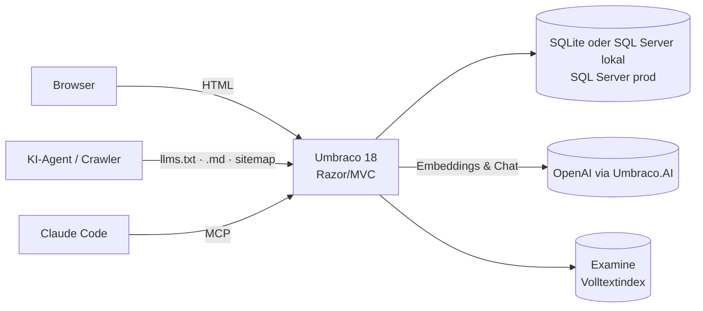

# Architektur

## Überblick

- **Ein Deployable:** `src/UmbracoAI.Web`. Kein Headless-Frontend, keine Content Delivery API ([ADR 0002](../adr/0002-razor-ohne-delivery-api.md)).
- **Code-first:** Inhaltsmodell, Sprachen, Dictionary, Starter-Inhalte und das AI-Setup werden beim Start von
  versionierten Seed-Steps angelegt ([ADR 0004](../adr/0004-code-first-seeding.md)).
- **Lokale Laufzeit:** `dotnet run` + SQLite oder Docker + SQL Server, beide unterstützt (offene [ADR 0003](../adr/0003-lokale-entwicklung-sqlite-oder-docker-sql-server.md)).
- **Konfiguration:** `appsettings.json` (Defaults) → `appsettings.{Environment}.json` → Umgebungsvariablen bzw. `.env`.

## Request-Fluss

| Pfad | Zuständig | Datei |
| --- | --- | --- |
| `/` | Redirect auf `/de/` | `Geo/AgenticEndpoints.cs` |
| `/de/…`, `/en/…` | Umbraco-Routing → Template `{docType}.cshtml` | `Views/` |
| `/robots.txt`, `/sitemap.xml` | Minimal-API | `Geo/AgenticEndpoints.cs`, `Seo/CrawlerFiles.cs` |
| `/llms.txt`, `/llms-full.txt`, `/{kultur}/llms.txt` | Minimal-API | `Geo/AgentMarkdownService.cs` |
| `/{seite}.md` | Markdown-Zwilling der Seite | `Geo/AgenticEndpoints.cs` |
| `/api/search?q=&culture=` | Hybride Suche (JSON, Rate Limit) | `Search/` |
| `/umbraco` | Backoffice | Umbraco |

## Mehrsprachigkeit

Kulturen sind in `Site/Cultures.cs` definiert (erste = Standard). Die Startseite bekommt je Kultur eine relative
Domain (`/de`, `/en`). Alle Seitentypen variieren nach Kultur, Bilder, Daten und Schalter sind invariant.

## Erweiterungspunkte

| Was | Wo |
| --- | --- |
| Neuer Seitentyp | `Seeding/Schema/PageTypeDefinitions.cs` + `Views/{alias}.cshtml` |
| Neues Modul | `Seeding/Schema/ElementDefinitions.cs` + `Views/Partials/blockgrid/Components/` |
| Neuer Seed-Step | `ISeedStep` implementieren, in `SeedComposer` registrieren |
| Neue Sprache | `Site/Cultures.cs`, `Site/UiTexts.cs`, Starter-Inhalte |
